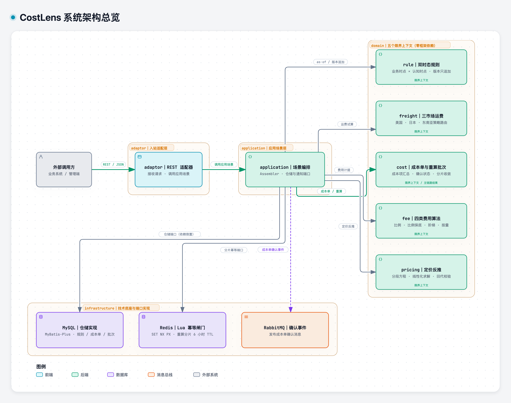

# CostLens · 跨境电商全成本核算与定价决策系统

> 同一笔成本，在不同平台、不同计算范式、不同时点算出的结果互不相同——所以记账必然混乱。
> CostLens 只做一件事：把它算准。



<p align="center"><sub>业务链路 → 限界上下文 → DDD 分层 → 技术底座；可交互版本：<code>docs/architecture.html</code>（本地浏览器打开）</sub></p>

业务背景与设计依据见 [`docs/01-业务方案.md`](docs/01-业务方案.md)，技术设计见 [`docs/02-系统设计说明书.md`](docs/02-系统设计说明书.md)，面试话术见 [`docs/03-亮点与简历手册.md`](docs/03-亮点与简历手册.md)。

---

## 1. 解决什么问题

跨境卖家的一笔订单成本，要同时经过多套互不相同规则：美国按计费重与邮编分区收运费，日本按三边和尺寸档收费，东南亚按首重续重计价；平台佣金还可能带最低收费和金额阶梯。费率调整、录错修正之后，如果直接覆盖旧规则，历史订单的成本与毛利又无法复现。

本工程只解决这条链上的问题：**把一票货的运费、平台费用和真实净利算准，并保留每一步的计算依据。**

| 痛点 | 代码里的解法 | 看哪里 |
|---|---|---|
| 三个市场计价因子与重量角色不同，统一模型会算错 | 三套独立计费策略 + 市场路由 + 整数化计价 | [`DimWeightZoneStrategy`](app/domain/src/main/java/com/costlens/domain/freight/service/strategy/DimWeightZoneStrategy.java) / [`GirthSizeBandStrategy`](app/domain/src/main/java/com/costlens/domain/freight/service/strategy/GirthSizeBandStrategy.java) / [`FirstAddWeightStrategy`](app/domain/src/main/java/com/costlens/domain/freight/service/strategy/FirstAddWeightStrategy.java) |
| 最低收费与金额阶梯让低价商品实际费率失真 | 四类费用算法 + 互斥规则 + 逐项明细汇总 | [`PercentageWithFloorRule`](app/domain/src/main/java/com/costlens/domain/fee/service/rule/PercentageWithFloorRule.java) / [`TieredByAmountRule`](app/domain/src/main/java/com/costlens/domain/fee/service/rule/TieredByAmountRule.java) |
| 费率变更或直接 UPDATE 后，历史账无法复现 | valid time + transaction time 双时态，只追加版本 + as-of 查询 | [`FeeRule`](app/domain/src/main/java/com/costlens/domain/rule/model/FeeRule.java) / [`BitTemporalResolver`](app/domain/src/main/java/com/costlens/domain/rule/service/BitTemporalResolver.java) |
| 佣金随售价分段变化，目标售价不能简单除算 | 价格轴分段枚举 + 段内线性化 + 回代校验 + 核价缺口 | [`PricingSolver`](app/domain/src/main/java/com/costlens/domain/pricing/service/PricingSolver.java) / [`LinearForm`](app/domain/src/main/java/com/costlens/domain/pricing/service/LinearForm.java) |
| 分片重算重复上报导致批次计数失真 | Redis Lua `SET NX PX` 原子幂等 + RabbitMQ 确认事件 | [`RedisIdempotencyGuard`](app/infrastructure/src/main/java/com/costlens/infrastructure/cost/redis/RedisIdempotencyGuard.java) / [`RabbitCostSheetNotifier`](app/infrastructure/src/main/java/com/costlens/infrastructure/cost/mq/RabbitCostSheetNotifier.java) |

---

## 2. 工程结构

严格按 DDD 六层 + easy-DDD 规范落地：

```
/pom.xml                         聚合根
/app/pom.xml                     DDD 聚合（packaging=pom，只声明 modules）
/app/domain                      costlens-domain          领域层，零技术依赖
/app/application                 costlens-application     场景编排 + Assembler
/app/infrastructure              costlens-infrastructure  仓储实现、PO、Mapper、Flyway
/app/adaptor                     costlens-adaptor         Controller、异常处理、Bean 装配
/common                          costlens-common          异常、错误码、Result、整数工具
/model                           costlens-model           跨层枚举
/client                          costlens-client          对外 DTO
/start                           costlens-start           启动模块
```

**层间依赖由 ArchUnit 强制校验**（[`ArchitectureTest`](start/src/test/java/com/costlens/ArchitectureTest.java)）：
- `domain` 不得依赖 Spring / MyBatis / Jackson 与任何上层
- `domain` 不得出现 `Double` / `Float` 装箱类型（计价链路禁止浮点）
- `adaptor` 不得依赖 `infrastructure`
- `application` 不得依赖 `infrastructure` / `adaptor`
- `infrastructure` 不得依赖 `application` / `adaptor`

**四种开发模式的实际使用**：

| 业务 | 模式 | 实现 |
|---|---|---|
| 计费 / 费用计算 | 规则+计算 | `FreightRatingService`、`FeeChargeService`（无状态，规则匹配与计算分离） |
| 费率版本管理 | 写模式 | `FeeRule`、`FreightRateCard`（聚合根 + 只追加版本） |
| 定价反推 | 纯计算 | `PricingSolver`（`DomainService`，无聚合根） |
| 成本单查询 | 读模式 | `CostSheetScenario.query` |

---

## 3. 快速开始

### 1. 启动依赖

```bash
docker compose up -d          # MySQL 8 + Redis 7 + RabbitMQ 3.12
```

首次启动 MySQL 约需 30 秒，Flyway 会在应用启动时自动建表并写入种子数据
（[`V1__init_schema.sql`](app/infrastructure/src/main/resources/db/migration/V1__init_schema.sql)、[`V2__seed_data.sql`](app/infrastructure/src/main/resources/db/migration/V2__seed_data.sql)）。

### 2. 构建与测试

```bash
./build.sh verify             # 全量构建 + 全部测试（固定 JDK 21）
./build.sh test               # 只跑测试
./build.sh run                # 启动应用（8080 端口）
```

> `build.sh` 固定 `JAVA_HOME` 为 JDK 21。若本机 JDK 25 直连 Maven，Lombok 注解处理器可能不兼容。

### 3. 接口验证

```bash
# 美国站运费试算：体积重生效，计费重 2000g × $12/kg = $24.00
curl -s -X POST localhost:8080/api/freight/quote -H 'Content-Type: application/json' -d '{
  "market":"US","serviceLevel":"GROUND","destZip":"90001",
  "actualWeightGram":1200,"lengthCm":30,"widthCm":20,"heightCm":15,
  "currency":"USD","quoteTime":"2023-03-15T10:00:00"
}' | jq

# 日本站运费试算：三边和 80cm 落 S80，重量只做上限校验
curl -s -X POST localhost:8080/api/freight/quote -H 'Content-Type: application/json' -d '{
  "market":"JP","area":"KANTO","actualWeightGram":3000,
  "lengthCm":26,"widthCm":27,"heightCm":27,
  "currency":"JPY","quoteTime":"2023-03-15T10:00:00"
}' | jq

# 东南亚运费试算：0.7kg 得 2 个续重
curl -s -X POST localhost:8080/api/freight/quote -H 'Content-Type: application/json' -d '{
  "market":"SEA","country":"MY","actualWeightGram":700,
  "lengthCm":10,"widthCm":10,"heightCm":10,
  "currency":"CNY","quoteTime":"2023-03-15T10:00:00"
}' | jq

# 平台费用计提：$100 电子类目 = 佣金 15% + 支付费 3%
curl -s -X POST localhost:8080/api/fee/charge -H 'Content-Type: application/json' -d '{
  "platform":"AMAZON_US","category":"ELECTRONICS","baseAmountMinor":10000,
  "currency":"USD","pieceCount":1,"volumeCubicCm":0,"weightGrams":0,
  "chargeTime":"2023-03-15T10:00:00"
}' | jq

# 成本单：运费 + 费用 + 固定成本 → 净利率
curl -s -X POST localhost:8080/api/cost/sheet -H 'Content-Type: application/json' -d '{
  "sheetId":"SHEET-1","orderNo":"ORD-1","platform":"AMAZON_US","category":"ELECTRONICS",
  "revenueMinor":2500,"currency":"USD","bizTime":"2023-03-15T10:00:00",
  "freight":{"market":"US","serviceLevel":"GROUND","destZip":"90001",
             "actualWeightGram":500,"lengthCm":10,"widthCm":10,"heightCm":10},
  "fixedCosts":[{"costType":"ADVERTISING","amountMinor":600,"ruleKey":"CPC"}]
}' | jq

# 定价反推：固定成本 $10、目标毛利 25% → 售价
curl -s -X POST localhost:8080/api/pricing/solve -H 'Content-Type: application/json' -d '{
  "platform":"AMAZON_US","category":"ELECTRONICS","fixedCostMinor":1000,
  "currency":"USD","targetMarginPercent":"25","pieceCount":1,
  "volumeCubicCm":0,"weightGrams":0
}' | jq

# 核价上限冲突：输出缺口金额而不是硬凑
curl -s -X POST localhost:8080/api/pricing/solve -H 'Content-Type: application/json' -d '{
  "platform":"AMAZON_US","category":"ELECTRONICS","fixedCostMinor":1000,
  "currency":"USD","targetMarginPercent":"25","priceCapMinor":1500,
  "pieceCount":1,"volumeCubicCm":0,"weightGrams":0
}' | jq

# 双时态查询：bizTime 2023-08-15 走 v2（6%）；传 knownAt 可复现历史认知
curl -s 'localhost:8080/api/rule/SHOPEE_MY_ALL_COMMISSION/as-of?bizTime=2023-08-15T00:00:00' | jq
```

完整接口清单见 [`docs/02-系统设计说明书.md`](docs/02-系统设计说明书.md) §五。

---

## 4. 测试

| 层次 | 用例数 | 覆盖 |
|---|---|---|
| 值对象与工具 | 16 | 金额舍入、多件重量累加浮点陷阱、三边和整数、`ceilDiv` 负数契约 |
| 双时态 | 11 | 业务时点 / as-of 认知时点、版本只追加、区间左闭右开 |
| 三市场计费 | 14 | 体积重生效、500g 进位、邮编前导零、Size 档边界、超重升档、续重取整 |
| 四类费用算法 | 10 | 最低收费临界、金额分段（$250 分界）、封顶、互斥组 |
| 定价求解 | 8 | 分段枚举、floor 退化、核价缺口、1000 组随机参数回代校验 |
| 成本单与批次 | 8 | 状态机、取代、批次 PARTIAL 收敛 |
| 端到端链路 | 11 | 三市场运费 → 费用 → 成本单 → 定价 → 批次 → 幂等拦截 → 事件广播（内存仓储，不依赖 DB） |
| Redis 幂等闸门 | 4 | Lua `SET NX PX` 原子占位、重复拦截、null 视为失败、非法参数 |
| HTTP 契约 | 4 | 请求反序列化、枚举解析、错误码、统一响应 |
| 架构守卫 | 5 | 分层依赖 + 禁止浮点 |

合计 **88 项**，`./build.sh verify` 全绿。

---

## 5. 实现范围与偏差记录

已完成（可运行、有测试）：

- 三市场运费计费、四类平台费用计提、双时态规则版本、定价分段求解、成本单与重算批次
- MySQL 持久化（Flyway DDL + 种子数据）、REST 接口、统一异常处理、ArchUnit 架构约束
- Redis + Lua 分片幂等闸门（`SET key val NX PX ttl` 单脚本完成检查+占位）
- RabbitMQ 成本单确认事件广播（持久化队列 + topic exchange）

**按设计文档预留但未实现**（演进项，非缺陷）：

| 项 | 现状 | 触发阈值（见 01 §七） |
|---|---|---|
| Redis 费率快照缓存 | 接口位置已留（`FreightRateCardRepository`），当前直连 DB；Redis 目前只用于幂等闸门 | 月 5k 单 |
| RabbitMQ 账单导入消费者 | 拓扑与发布端已就绪，导入消费者未实现 | 月 5 万单 |
| PowerJob 分片重算 | 批次聚合根、状态机、幂等分片回报已实现，调度器未接入 | 月 50 万单 |
| 附加费（燃油周表 / 偏远 / 離島） | `SurchargeCalculator` 扩展点已留，默认返回 0 | 需接入公开燃油周表 |

**与设计文档的偏差**：

1. `Money` / `Weight` / `Length3` / `Rate` / `JpSizeBand` 放在 `domain.shared.model`（共享内核），而非某一上下文的 `model` 包——避免五个上下文循环引用。
2. `CostItem.ruleType` 由 `ChargeRuleType` 改为 `String`：运费项不属于费用计提算法，塞进枚举会让语义失真。
3. `@MapperScan` 从启动类移到 [`PersistenceConfig`](app/infrastructure/src/main/java/com/costlens/infrastructure/PersistenceConfig.java)，使 Web 切片测试不误加载 Mapper。